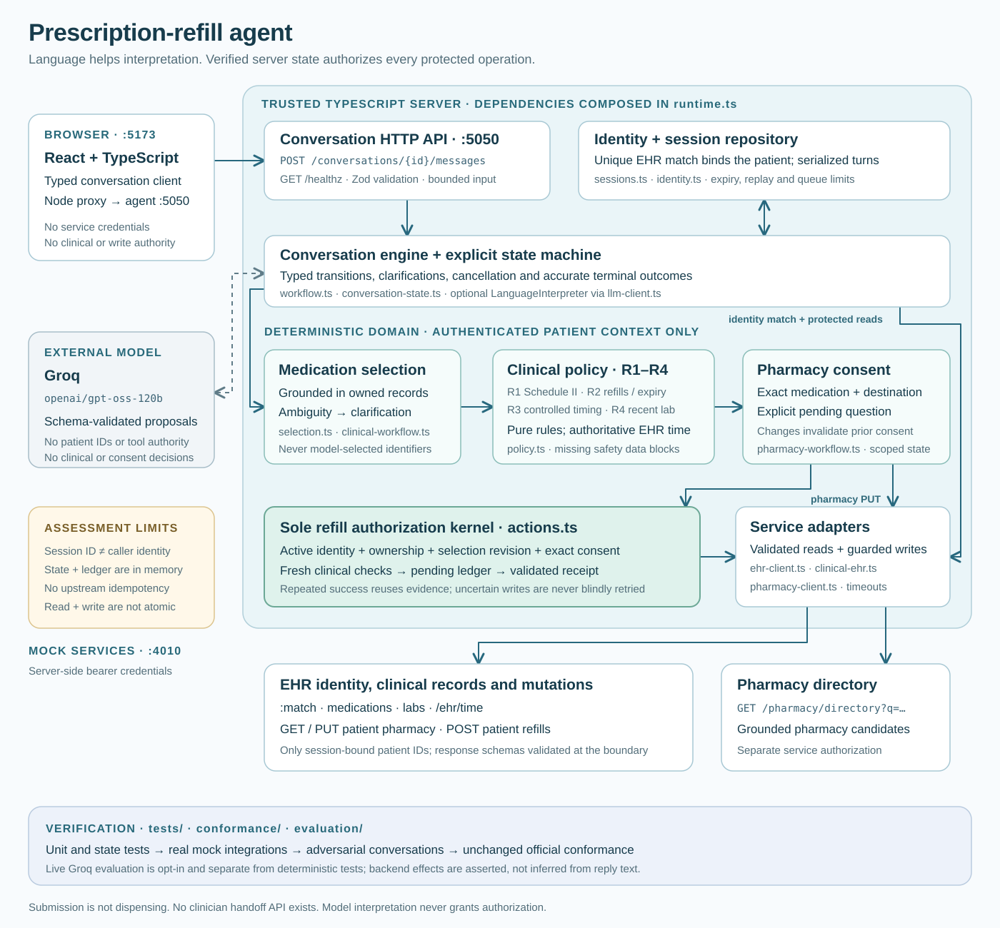

# Prescription-Refill Agent

A local healthcare-agent assessment with a React and TypeScript conversation interface, a Node.js HTTP agent, and the supplied synthetic EHR/pharmacy services. The agent verifies identity, selects an owned prescription, applies deterministic clinical rules, obtains explicit pharmacy consent, and submits an eligible refill.

The model interprets language; server-side code controls identity, clinical eligibility, consent, and mutations. Submission means a refill request reached the EHR, not that medication was dispensed.

[API contract](docs/API.md) · [Manual testing guide](docs/MANUAL_CHAT.md) · [Submission details](SUBMISSION.md) · [Original assessment](docs/ASSESSMENT.md)

## Requirements and installation

Use **Node.js 24 LTS** and npm. The preserved release evidence was collected with Node **24.22.3** and npm **11.19.1**; select a supported runtime in every terminal.

```powershell
node --version
npm --version
npm ci
```

The lockfile is committed. Use npm exclusively. The application uses strict TypeScript, Zod, native Node HTTP/fetch, and Node's built-in test runner. The frontend uses React, TypeScript and esbuild with a small Node proxy; it does not use Vite or a CDN.

Keep credentials in the local environment. [.env.example](.env.example) contains placeholders only; do not overwrite an existing `.env` or put keys into source code. The agent entry point and explicitly invoked smoke/live-evaluation CLIs can load that optional file; caller-supplied variables take precedence. The frontend and mock do not load it.

## Run the application

### Mode A: API only

Start the paired synthetic backend services:

```powershell
npm run dev:services
```

This starts the unchanged mock on **4010** and the existing agent entry point on **5050**, using matching temporary service credentials. Model settings are forwarded only to the agent, which can also load its optional local configuration. The mock never receives the Groq key. Ctrl+C stops the owned pair.

For independent evaluator startup, the original commands remain available in separate terminals:

```powershell
npm run mock
```

```powershell
npm run agent
```

The standalone agent command is exactly **`npm run agent`**, which runs `tsx agent/start.ts`. Supply the required variables below, and configure the mock with matching synthetic EHR/pharmacy service tokens. The agent also runs entirely from supplied environment variables without a local file. Do not export real provider credentials into the mock terminal: the provided mock prints its effective service tokens.

With the services running, execute the unchanged checker in another terminal:

```powershell
npm run conformance
```

### Mode B: complete browser application

```powershell
npm run dev:all
```

Open **http://127.0.0.1:5173**. One launcher builds the frontend, starts its loopback Node proxy, and starts the paired mock and agent. Ctrl+C cleans up its owned services. Existing listeners are not replaced.

If the mock and agent are already running correctly, start only the frontend:

```powershell
npm run dev:frontend
```

Use the exact `127.0.0.1` address: the proxy restricts Host/Origin and forwards only validated patient JSON to the fixed agent origin. Restart the frontend command after source changes; startup performs the esbuild build rather than hot reload.

The browser displays actual messages, public conversation state, service-health results, and the latest response JSON/status/duration. It never receives service or model credentials. **New conversation** creates a new ID; **Clear local display** preserves the current ID, backend session, and previous actions. Neither operation resets the backend.

## Configuration

| Variable | Requirement / default |
| --- | --- |
| `GROQ_API_KEY` | Required model credential; never logged or sent to the mock. |
| `LLM_MODEL` | `openai/gpt-oss-120b` by default. |
| `EHR_API_KEY`, `PHARMACY_API_KEY` | Required service tokens for standalone agent startup; paired launchers provide temporary synthetic values. |
| `EHR_BASE_URL` | `http://127.0.0.1:4010`. |
| `PHARMACY_BASE_URL` | Defaults to the configured EHR origin. |
| `AGENT_PORT` | `5050`; integer 1–65535. |
| `REQUEST_TIMEOUT_MS` | `10000`; integer 100–60000, used by model/service transport. |
| `LLM_MAX_RETRIES` | `2`; 0–3 additional transient interpretation attempts. |

Service URLs must be bare origins without userinfo, paths, queries or fragments. Remote service origins require HTTPS; HTTP is accepted only for loopback development. Invalid configuration fails at startup with variable names, never rejected values.

The Groq adapter uses `https://api.groq.com/openai/v1/chat/completions`, model `openai/gpt-oss-120b`, temperature **0**, `max_completion_tokens=2048`, low reasoning effort, hidden reasoning, nonstreaming responses, and strict JSON Schema. The provider does not supply an immutable deployment revision through this configuration.

## Conversation API

The authoritative contract is [docs/API.md](docs/API.md). Reuse the same conversation ID across turns:

```http
POST /conversations/{conversationId}/messages
Content-Type: application/json

{"from":"patient","text":"Please refill my medication."}
```

```json
{
  "messages": [{"from": "agent", "text": "A returned agent message."}],
  "state": "in_progress"
}
```

The response above illustrates the schema, not an executed conversation. Public states are `in_progress`, `complete`, and `escalated`. A completed cancellation is also `complete`; inspect the returned text. Escalation stops the conversation and does not establish that a clinician was contacted. `GET /healthz` returns `{"ok":true}` when the listener is ready; it does not test model connectivity or service credentials.

Identity requires first name, last name, a valid ISO date of birth, and phone ending or ZIP. A unique EHR `:match` result binds the patient ID. This factor policy and the five-failed-attempt limit are application decisions permitted by the specification, not a separate patient-login API.

### Synthetic four-message example

The following actual message sequence was verified against the supplied seed. After a fresh mock start Alice's pharmacy is Mission Rx; later updates can change the live assignment.

| Patient message, sent one at a time | Verified behavior |
| --- | --- |
| `Hello, I need a prescription refill.` | Ask for identity; `in_progress`. |
| `Alice Nguyen, DOB 1988-03-12, phone ending 1234.` | Verify identity, then ask for medication/strength; `in_progress`. |
| `Please refill my Lisinopril 10mg.` | Identify the owned eligible prescription and present the current pharmacy with a submission question; `in_progress`. |
| `Yes, keep my pharmacy.` | Submit one permitted refill and return `complete`. |

The recorded successful reply was: “For Lisinopril 10mg at Mission Rx: Your refill request was submitted to the EHR service. This confirms submission, not dispensing or a new prescription.”

Repeating confirmation in that same conversation does not create another write. A new conversation is independently authenticated and is not global duplicate protection. More synthetic fixtures, pharmacy-change steps and a 30-case expected-behavior checklist are in [the manual guide](docs/MANUAL_CHAT.md).

## Architecture and trust boundaries



| Boundary | Implementation |
| --- | --- |
| Public HTTP validation and safe diagnostics | `agent/http-server.ts`, `validation.ts`, `observability.ts`. |
| Conversation state machine and orchestration | `conversation-state.ts`, `workflow.ts`; exhaustive typed transitions and deterministic sensitive replies. |
| Session repository | `sessions.ts`; immutable snapshots, patient binding, serialized turns, expiry, revision checks and bounded queues. |
| Identity adapter | `identity.ts`, `ehr-client.ts`, `ehr-http.ts`; validated factors and unique-match evidence. |
| Authorized clinical reads and prescription matching | `patient-clinical.ts`, `clinical-ehr.ts`, `selection.ts`, `clinical-workflow.ts`. |
| Pure clinical policy | `policy.ts`; no model, HTTP, environment or persistence dependency. |
| Pharmacy directory, selection and consent | `pharmacy-client.ts`, `pharmacy-selection.ts`, `pharmacy-state.ts`, `pharmacy-workflow.ts`. |
| Sole refill action boundary | `actions.ts`; fresh checks, scoped confirmation, pending ledger and validated immutable receipt. |
| Language interpretation | `intent.ts`, `interpretation.ts`, `llm-client.ts`; narrow interface and untrusted validated proposals. |
| Dependency composition | `runtime.ts`; complete executable composition and an injectable clinical core retained for isolated tests. |
| Browser client | `frontend/src/`; typed API client, focused hooks/components and ephemeral React state. |
| Optional live evaluation | `evaluation/`; real HTTP orchestration, synthetic fixtures, bounded provider instrumentation and sanitized reports. |

The implementation uses State Machine, Adapter, Repository, pure Policy and Dependency Injection patterns where they enforce reviewable boundaries. No database, Redis, queue service, agent framework or tool-execution layer is required.

Typical flow: collect identity → unique match → retrieve owned prescriptions → clarify/select a real medication → evaluate policy → present pharmacy → obtain scoped consent → revalidate → submit. Directory search and exact destination confirmation precede a pharmacy PUT. Its readback is followed by a **separate refill confirmation**. Changed medication, destination or question invalidates prior consent.

The LLM has no patient-ID field, action permissions, EHR client or tool interface. Extracted identity factors must be grounded in the current message. Medication matching retains literal strength/formulation constraints and selects only actual owned records; ambiguity asks a question. The interpreter receives a bounded patient message, not complete records or raw conversation history. Deterministic messages avoid unnecessary model calls.

## Deterministic clinical rules

All date logic uses **`GET /ehr/time`**, never the workstation date. The mock's supplied time is `2026-09-01T12:00:00Z`.

| Rule | Exact authorization condition |
| --- | --- |
| R1 — Schedule II | A prescription with `schedule === "CII"` is not refillable here: decline and escalate to the prescriber. |
| R2 — Refills / expiration | If `refillsRemaining === 0` or expiration is strictly before EHR time, decline and escalate for a new prescription. Equality alone does not expire a prescription. |
| R3 — Controlled early refill | For CIII–CV, decline when `now < lastFilledDate + daysSupply - 2 days`; the exact threshold is allowed subject to other gates. |
| R4 — Required recent lab | A matching lab type must fall within the inclusive window `[now - withinDays, now]`; future labs do not qualify. Otherwise hold/escalate. No lab-value threshold is invented. |

UTC date-only values mean midnight; a day is 86,400,000 ms. Invalid or inconsistent clinical inputs fail closed. R3/R4 use terminal escalation as the conservative documented application choice. No handoff endpoint exists, so the agent never claims a clinician was contacted.

Before the single refill POST, the action kernel rereads owned medication, authoritative time, required labs and current pharmacy. It checks the active repository-issued patient context, exact prescription/name/query revision, and saved pharmacy question/consent.

## Reliability, privacy and transaction handling

- Sessions are process-local, capped at 1,000 entries, with 30-minute inactivity expiry and at most 32 pending turns per conversation. Turns are serialized; independent conversations remain isolated.
- Terminal states, cancellation and expired leases cannot authorize new actions. Retained accepted/unknown action evidence takes precedence over fresh intent after an interrupted state commit.
- A pending ledger is written before dispatch. Repeated successful turns reuse receipts. Unknown refill outcomes stop; potentially successful writes are never blindly retried.
- Pharmacy PUT is sent once and reconciled by a supported readback when possible. A confirmed change followed by refill failure remains partial success; no silent rollback is claimed.
- Safe reads and model calls have bounded retries, exponential backoff/jitter and Retry-After handling. Permanent/schema failures fail explicitly. PUT/refill POST are single-attempt.
- HTTP input, service replies and model output use runtime validation, bounded response sizes, strict UTF-8 decoding and request/body deadlines. Redirects are rejected by credential-bearing clients.
- Diagnostics retain correlation IDs, safe categories, status and duration, not patient conversations, demographic factors, prompts, credentials or raw upstream errors.
- The frontend is a loopback development tool with fixed upstreams, no forwarded client credentials and no automatic conversation retries. A timeout can mean an action was processed; verify before repeating confirmation.

## Tests and release checks

Routine tests are deterministic, use synthetic data/fake interpreters and isolated unchanged mock services, and require **no real API key**. Integration assertions inspect ownership, ordering, actual mutation counts and receipts instead of relying only on chatbot text. Fault/concurrency tests use explicit gates and injected clocks; clinical boundary cases use independent UTC expectations.

```powershell
npm test
npm run typecheck
npm run test:coverage
npm run build:frontend
npm run typecheck:frontend
npm run test:frontend
npm audit
```

Run `npm run conformance` with correctly paired services as described above. It uses the unchanged supplied checker and performs a synthetic refill; avoid concurrent manual tests because its mock log reset affects shared call evidence.

| Requirement | Principal verification |
| --- | --- |
| Exact HTTP schemas, lifecycle and bounded input | `transport`, `conversation-state`, `hardening-transport` tests. |
| Authentication, incorrect/missing factors and patient isolation | `identity`, `ehr-client`, `workflow`, `auth-integration`, `evaluation-security` tests. |
| Grounded medication selection and changed strength/formulation | `selection`, `clinical-workflow`, `evaluation-policy`, `evaluation-conversations` tests. |
| R1–R4, authoritative time, inclusive/exclusive boundaries | `policy`, `clinical-integration`, `evaluation-policy`, `hardening-actions` tests. |
| Pharmacy choices, consent, update/readback and actual completion | `pharmacy-*` tests and unchanged official conformance. |
| Replay, concurrent turns, queue/expiry/cancellation and uncertain writes | `sessions`, `actions`, `evaluation-resilience`, `hardening-sessions` tests. |
| Model schema, retries, faults and injection boundaries | `llm-client`, `evaluation-language`, `evaluation-security`, `live-*` tests. |
| Typed frontend transport, local display/session controls and build | `frontend/tests/` and `tests/manual-chat.test.ts`. |

Coverage reports separate weighted **application-only** `agent/**/*.ts` counters from native all-files coverage, which includes tests/support/evaluation. Statement coverage is unavailable. An empty source table is not measured coverage; a regression verifies collection beneath a directory named `test`.

**Final release verification (2026-11-23):** Node **24.22.3** / npm **11.19.1**; `npm ci` succeeded. Both ordinary and native-coverage runs passed **534/534 tests**, with **zero failures, cancellations or skips**. All original 504 cases remain unchanged; 15 React/client/build tests and 15 proxy/development-launcher tests extend them. Backend and frontend TypeScript checks, the React production build, unchanged official conformance and npm audit passed; audit reported **zero vulnerabilities**.

Collected application-only coverage across 31 `agent/**/*.ts` modules: **99.09% lines** (2845/2871), **94.60% branches** (1297/1371), **96.08% functions** (294/306). Native all-files coverage, including tests/support/frontend/evaluation, was **98.74% lines, 93.52% branches, 94.02% functions**. Line coverage includes the added purpose comments and is not evidence of a behavioral improvement.

The final proxy was exercised with the real agent and unchanged mock through **three synthetic HTTP conversations / 14 turns**: current-pharmacy refill plus repeated confirmation, Schedule II refusal, and a pharmacy change with separate refill consent. Actual effects were **two intended refill POSTs, one pharmacy PUT, zero blocked writes and zero duplicate writes**. Exact replies and safe call metadata are in [the final UI evidence](docs/evaluation/final-ui-evidence.json). The owned launcher also shut down all three ports cleanly. React interaction tests use an isolated DOM; browser screenshots validate rendering, while these HTTP checks validate the real orchestration path.

Two new defects were reproduced with failing regressions and repaired: a pre-aborted client request could still start transport, and unexpected development-child failures could appear to exit successfully. The backend changes in this delivery are purpose comments; clinical, authentication and mutation logic are preserved. Supplied API, mock, conformance and the original 504 test files are unchanged.

## Live Groq evidence and reproduction

[Sanitized recorded evidence](docs/evaluation/phase8-live-evidence.json) preserves the executed HTTP responses, safe service-call metadata, receipts and strict provider-validation results.

| Recorded observation | Result |
| --- | --- |
| Runtime | Node 24.22.3 LTS / npm 11.19.1. |
| Model | Groq `openai/gpt-oss-120b`, strict schema, temperature 0, max 2048 completion tokens, low/hidden reasoning. |
| Live attempts | 13 instrumented harness requests plus 1 separate smoke request; no retries or rate-limit events. |
| Labeled interpretations | 13/13 intent labels across **eight distinct prompt texts**; 10/10 exact medication-query labels, 1/1 pharmacy-query label, 2/2 identity fields. |
| Structured/model verification | 13/13 valid interpretations and returned expected-model metadata; zero missing/mismatched responses. |
| End-to-end scenarios | 12/12 expectations passed across 63 actual HTTP turns: six submitted, five clinical stops, one safely unresolved consent workflow. |
| Backend effects | Six intended refill POSTs, one pharmacy PUT; zero observed unauthorized operations, clinical violations or unintended duplicate writes. |
| Provider latency | Median 690.35 ms; nearest-rank p95/max 798.36 ms, n=13, including bounded metadata reading. |
| Token metadata | 7,412 prompt + 1,852 completion = 9,264 tokens; separate smoke usage was not collected. |

The small repeated set is **not a general accuracy estimate**. Most medication scenarios restate the exact request before deterministic matching; pharmacy-change interpretation is tested before authentication. The incremental name case exercises model-dependent authentication intake. No real provider failure occurred; controlled failure recovery is offline evidence.

Live evaluation is opt-in and separate from `npm test`:

```powershell
npm run eval:live -- --list
# Only after the exposed credential is revoked and a replacement is configured locally:
npm run smoke:groq
npm run eval:live -- --confirm-rotated-key
```

The harness creates isolated services rather than modifying a running demo. It serializes calls with at least two seconds between dispatches, disables retries, allows at most 39 harness attempts plus one separately budgeted smoke request, and stops on quota/authentication/model/provider errors. It does not enable billing or select a paid fallback. The acknowledgement records the operator's statement; it cannot independently verify provider-side revocation.

## Known limits and delivery notes

| Limitation | Consequence / production requirement |
| --- | --- |
| Conversation ID is a routing key without an authenticated caller principal | A known ID does not prove caller ownership; production needs an authenticated gateway and ownership binding. |
| Sessions and mutation ledgers are in memory | Restart clears authentication/consent and duplicate history; independent conversations/processes can repeat a logical refill. Production needs durable scoped transaction evidence. |
| No upstream idempotency key or authoritative refill-history reconciliation | Global exactly-once submission cannot be guaranteed; uncertain actions need supported reconciliation. |
| Clinical reads, pharmacy reads and refill POST are not atomic | Fresh checks reduce staleness but cannot prevent external changes between the last read and write; production needs conditional/transactional backend authorization. |
| Synthetic matching and four assessment rules only | Stronger identity proof, clinical review, privacy/compliance review, audit controls, secrets management, monitoring and incident response remain necessary for real patients. |
| Limited live sample and no induced real-provider faults | Broader unseen-language, model-version drift and real-provider recovery evaluation remain open. |

A historical model credential was committed in the legacy repository. The owner confirmed revocation and replacement before the recorded live run; this was not independently audited in the provider account. Local `.env` remains excluded. Historical remediation and a credential-safe delivery history must be verified separately from application tests.

Release scans use Gitleaks **8.30.1** with its default rules. [.gitleaks.toml](.gitleaks.toml) excludes only one exact synthetic pharmacy-token literal in the unchanged integration fixture; it does not exempt a directory or real credential format. The source scan passed after reviewing those two fixture occurrences. The legacy history scan still correctly detected `.env`; only a separately sanitized `main` may be delivered. Recovery backups remain outside the submitted repository.

Redundant phase reports and duplicate architecture/requirements/testing prose were consolidated here. The obsolete `manual-chat/` prototype was removed; `frontend/` is the maintained React implementation. Tests, evaluation fixtures, supplied services/checker and the original assessment remain available.

The candidate's requested delivery target is [Karim-Bennia/Prescription-Refill-Agent](https://github.com/Karim-Bennia/Prescription-Refill-Agent), on `main`. Delivery uses an isolated sanitized copy and a normal push to the new empty repository; the legacy remote is not overwritten. The original assessment is preserved verbatim in [docs/ASSESSMENT.md](docs/ASSESSMENT.md).

The candidate reports that Artera waived Codex transcript delivery. That waiver was not independently verified; no transcript export is included on that basis.
